<p align="center">
  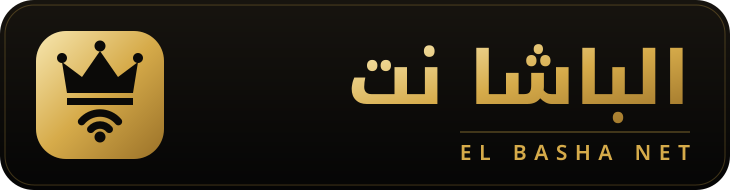
</p>

<h1 align="center">الباشا نت | El Basha Net</h1>
<p align="center"><b>قوالب هوتسبوت ميكروتك فاخرة + سكربت تجهيز كامل للشبكة</b></p>

<p align="center">
  <a href="LICENSE"></a>
  
  
  
</p>

نظام قوالب هوتسبوت مايكروتك متعدد التصاميم الاحترافية لشبكة **الباشا نت (El Basha Net)** بنظام الكروت الفردي (Single Voucher Code) مع واجهة مدمجة لأماكن ونقاط بيع الكروت، وتشفير CHAP MD5 وحماية متكاملة ضد التخمين.

---

## 🎨 القوالب المتوفرة (Available Themes)

كل قالب مجلد مستقل في `themes/<id>/` يضم شعاره في `assets/logo.svg` وأربع صفحات: `login.html` و`status.html` و`alogin.html` و`logout.html`. الصفحات مكتفية ذاتياً (CSS وJS مضمّنان، بلا خطوط أو مكتبات خارجية)، فتعمل قبل أن يملك المستخدم إنترنت.

| المعاينة | الشعار | القالب | المعرّف | الطابع |
| :---: | :---: | :--- | :--- | :--- |
| 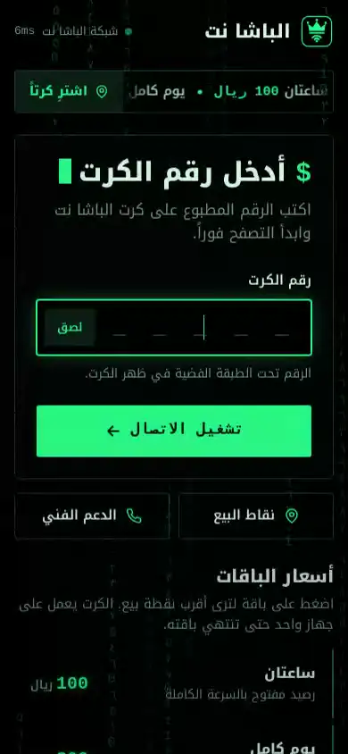 | 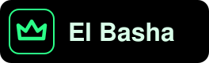 | **OLED Matrix** | `oled-matrix` | أسود مطلق، نافذة طرفية، مطر أرقام عربية خافت |
| 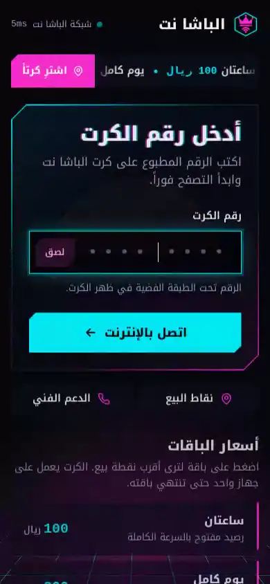 | 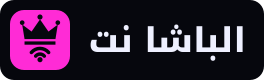 | **Cyberpunk Neon** | `cyberpunk` | أفق نيون بشمس مخططة وأرضية شبكية متحركة وزوايا مشطوفة |
| 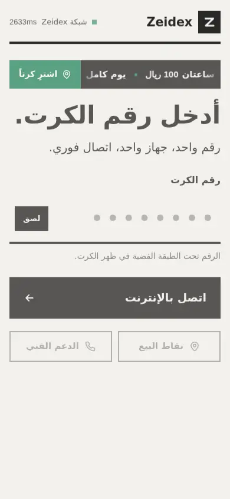 | 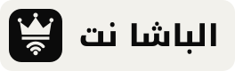 | **Swiss Minimal** | `swiss-minimal` | ورق فاتح وحبر أسود وشبكة صارمة واسم El Basha بعرض الصفحة |
| 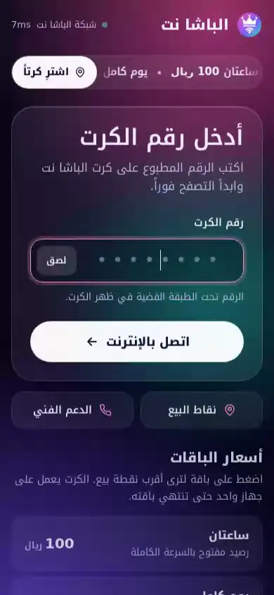 |  | **Aurora Glass** | `aurora-glass` | شفق قطبي متحرك خلف لوحة زجاجية متجمدة |
| 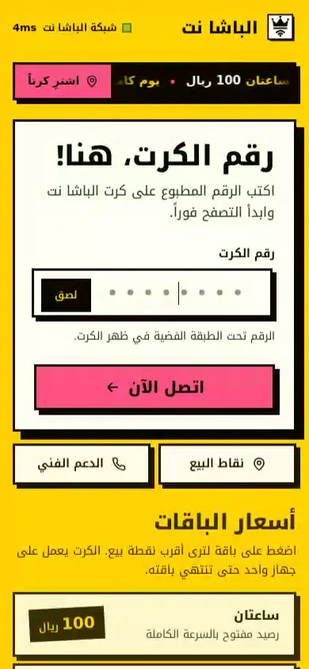 |  | **Neo-Brutalist** | `neo-brutalist` | أصفر وحدود سوداء عريضة وظلال صلبة وشريط أسعار متحرك |
| 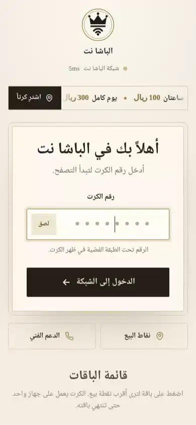 |  | **Luxury Champagne** | `luxury-gold` | عاجي وذهب مسطح بخط نسخ وقائمة أسعار فندقية (المفعّل حالياً) |
| 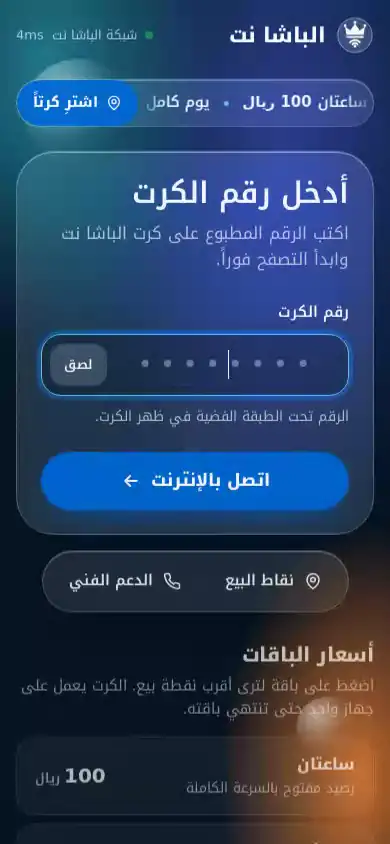 |  | **Spatial Glass** | `spatial-glass` | زجاج عميق، لوحة تميل مع المؤشر، شريط خدمات بأسلوب Dock |
| 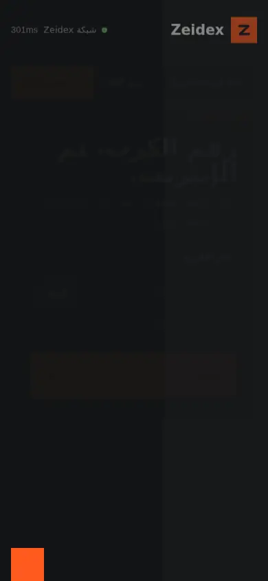 | 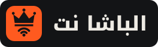 | **Nordic Studio** | `nordic-studio` | بازلت داكن ولمسة برتقالية واحدة وعنوان معماري كبير |

ما تشترك فيه كل القوالب:
- تشفير CHAP MD5، مع رجوع إلى PAP إن لم يرسل الراوتر `chap-id`.
- ترجمة رسائل خطأ الراوتر الشائعة إلى العربية (رقم خاطئ، انتهاء الوقت أو البيانات، الكرت مستخدم على جهاز آخر).
- قائمة الباقات ظاهرة مباشرة، ونافذتا نقاط البيع (مع بحث يتجاهل الهمزات والتاء المربوطة) والدعم الفني.
- دعم لوحة المفاتيح وقارئات الشاشة، واحترام إعداد `prefers-reduced-motion`.
- طلب قياس زمن استجابة واحد فقط عند الفتح، حتى لا يُحظر المستخدم بقاعدة Anti-Brute Force.
- خطوط عربية مضمّنة في [`fonts/`](fonts) (Noto Kufi Arabic للواجهات، Noto Naskh Arabic لقالب luxury-gold): ملفات woff2 مقتطعة بحجم 170KB يخدمها الراوتر نفسه، فتظهر قبل أن يملك المشترك إنترنت. الرخصة: [`fonts/OFL.txt`](fonts/OFL.txt).
- دخول تلقائي بمسح رمز QR على الكرت، وصفحة ترحيب تنقل المشترك إلى صفحة الشبكة.

- **المعاينات:** صور متحركة في `previews/<id>.webp` (خطأ الإدخال، تقسيم رقم الكرت، نافذة نقاط البيع) وصورة ثابتة في `previews/<id>.png`. لإعادة توليدها بعد أي تعديل:
  ```bash
  npm i --no-save playwright && npx playwright install chromium   # مرة واحدة، ويلزم ffmpeg
  node scripts/make-previews.mjs                                 # أو: node scripts/make-previews.mjs luxury-gold
  ```
  تتولد تلقائياً أيضاً عبر GitHub Actions ([`previews.yml`](.github/workflows/previews.yml)) عند أي تعديل على القوالب أو الخطوط في `main`.
- **معرض القوالب:** [`gallery.html`](gallery.html) يعرض كل قالب حياً داخل إطار هاتف (`http://localhost:3000/gallery.html`).

---

## 🛠️ تبديل القوالب (Switching Themes)

ينسخ الأمر صفحات القالب الأربع إلى جذر المشروع:
```bash
./scripts/switch-theme.sh [oled-matrix | cyberpunk | swiss-minimal | aurora-glass | neo-brutalist | luxury-gold | spatial-glass | nordic-studio]
```

---

## 📜 إعداد الراوتر (RouterOS v7)

سكربت واحد يجهّز الشبكة كاملة: [`scripts/elbasha_turnkey.rsc`](scripts/elbasha_turnkey.rsc).

1. عدّل المتغيرات في "البلوك 0" أعلى الملف: المنافذ، العناوين، الباقات، سرعة الخط، DNS، بيانات API محفظة شلن.
2. ارفع الملف إلى الراوتر ثم نفّذ: `/import file-name=elbasha_turnkey.rsc verbose=yes`
3. إعادة التشغيل آمنة: لا يحذف كروت `/ip hotspot user` ولا بروفايلاتها، ويستبدل فقط قواعده التي تحمل التعليق `ElBasha:`.

ما يفعله:
- بروفايل `ElBasha_Profile` باسم `elbasha.net` بدخول `http-chap` (مشفّر) و`cookie`. `http-pap` اختياري عبر `ebAllowPap` كخيار احتياطي حين لا يرسل الراوتر `chap-id`.
- DHCP مع `add-arp=yes` و`arp=reply-only` على الجسر، فلا يعمل آيبي مكتوب يدوياً، وكشف خوادم DHCP الدخيلة (Rogue DHCP alert).
- عزل المشتركين: `horizon=1` على منافذ الجسر، وقاعدة forward تمنع الحركة بين المشتركين.
- حجز آيبيهات ثابتة لأجهزة الأكسس بوينت والسيرفرات (`ebStatic`) وإعفاؤها من صفحة الدخول (Bypassed).
- DNS حماية العائلة (AdGuard Family) مفروض على الجميع، مع رفض DoT/DoH بـ `tcp-reset` سريع فيرجع المتصفح تلقائياً إلى DNS الشبكة بلا تعليق.
- Walled Garden لمحفظة شلن (`qtbbank.com`)، ومستخدم API بصلاحيات `api,read,write` فقط عبر API-SSL ومقيد بعنوان السيرفر.
- باقات `eb-1M` و`eb-2M` و`eb-4M` بـ `shared-users=1`. الصلاحية من `limit-uptime` على الكرت نفسه (مدة الاستخدام، يفرضها RouterOS داخلياً) بلا كتابة على الفلاش أثناء التشغيل.
- PCQ + Queue Tree بأربع أولويات: DNS/Ping/ألعاب/دردشة، ثم التصفح، ثم الباقي، ثم التحميلات الثقيلة والتحديثات.
- منع مشاركة النت (TTL=1) مع استثناء مكالمات الواي فاي (IPsec/IKE) وICMP، قابل للإيقاف بـ `ebAntiTether`. وFastTrack للأجهزة الثابتة فقط.
- حماية الراوتر من الإنترنت: إسقاط الحزم التالفة، ومنع الوصول من WAN إلى بوابة الدخول وإلى Winbox/SSH/API/الويب (إدارة داخلية فقط، أو من `ebAdminAllow`).
- نسخ احتياطي يومي للكروت واستهلاكها، ودفعة يومية لطيفة تحذف الكروت المستنفَدة، وإعادة تشغيل أسبوعية 4 فجراً، وWatchdog.
- حماية منافذ خادم الهوتسبوت `64872-64875`: حدود واسعة (`ebMaxOpenConn`/`ebNewPerMin`، افتراضياً 150) تناسب الهواتف الحديثة، مع حظر 15 دقيقة لمن يتجاوزها.

## 👑 الهوية البصرية

| الملف | الاستخدام |
| :--- | :--- |
|  | [`assets/logo.svg`](assets/logo.svg) الشعار الكامل: تاج فوق موجات Wi-Fi، والاسم مرسوم كمسارات (لا يحتاج خطاً) |
|  | [`assets/logo-mark.svg`](assets/logo-mark.svg) الرمز وحده: أيقونة، صورة حساب، ختم على الكرت |

الألوان: ذهبي `#d6ab4a` (تدرج `#f7e7b0` إلى `#9a7128`) وأسود عميق `#0b0a08`. كل قالب يحمل الرمز نفسه بألوانه في `themes/<id>/assets/logo.svg`.

## 🎫 طباعة الكروت

**استوديو كروت الباشا نت** — افتح [`vouchers/vouchers.html`](vouchers/vouchers.html) في المتصفح. يعمل بلا إنترنت وبلا تثبيت أي برنامج؛ أبقِ `qrcode.min.js` بجواره.
- **برنامج الطباعة المجاني هو المتصفح نفسه**: زر "توليد وطباعة" يفتح نافذة الطباعة — اطبع على ورق أو احفظ PDF.
- **تصميم كل الفئات**: جدول فيه كل باقة بلونها (جدول تعديل مباشر: الاسم، السرعة، السعر، الصلاحية، بروفايل الراوتر، العدد، اللون). "+ إضافة فئة" و🗑 لحذفها. زر "معاينة التصميم" يعرض كرتاً من كل فئة.
- 21 كرتاً في صفحة A4 مع خطوط قص. خيار "خلط الفئات في صفحة واحدة" يوزّعها بالتناوب، وإلا فصفحات منفصلة لكل فئة.
- التعديلات تُحفظ في المتصفح تلقائياً (localStorage)، و"استعادة الافتراضي" يرجّعها.
- رمز QR يفتح `http://elbasha.net/login?v=<الرقم>` فتملأ صفحة الدخول الرقم وتدخل بتشفير CHAP تلقائياً.
- عند التوليد تظهر أوامر `/ip hotspot user add` جاهزة للصق في Terminal، كل كرت ببروفايل فئته.
- عند الطباعة: مقياس 100% وتفعيل "رسوم الخلفية / Background graphics".

## English

**El Basha Net (الباشا نت)** is a set of 8 MikroTik hotspot themes. Each `themes/<id>/` folder holds `login.html`, `status.html`, `alogin.html`, `logout.html` and `assets/logo.svg`. Pages are self-contained (inline CSS/JS, no external fonts or CDNs), so they load before the client has internet access.

- **Login:** HTTP-CHAP (MD5) with the router's `chap-id`/`chap-challenge`; MikroTik error messages are translated to Arabic.
- **Switch theme:** `./scripts/switch-theme.sh <id>` copies the four pages to the repository root.
- **Router setup:** edit "Block 0" variables in `scripts/elbasha_turnkey.rsc`, upload it, then run `/import file-name=elbasha_turnkey.rsc`. Non-destructive: existing hotspot users and profiles are kept.
- **Vouchers:** `vouchers/vouchers.html` prints 21 QR vouchers per A4 page; the QR opens `/login?v=CODE`, which signs in via CHAP.
- **Preview:** open `gallery.html` from a local web server to see every theme live.

---

## 📄 الترخيص (License)
مرخص تحت رخصة **[MIT License](LICENSE)** للاستخدام المفتوح. الخطوط تحت رخصة [SIL OFL 1.1](fonts/OFL.txt).

---

<p align="center">تم التطوير بواسطة <a href="https://zeidexlink.zeidexsoft.com/zeidex"><b>zeidexsoft</b></a></p>
